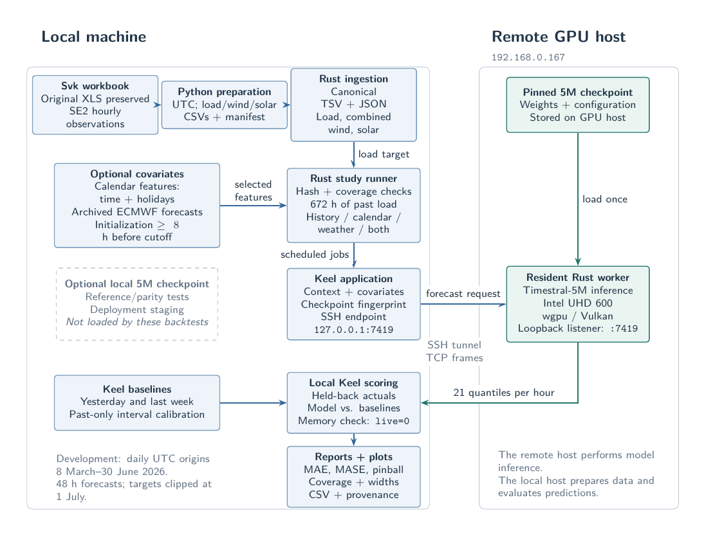

# SE2 energy forecasting in Keel

Keel owns the hourly grid, forecast requests, baselines, walk-forward scoring and checked fixed-point metric calculations. A Rust/wgpu worker runs the original Timestral transformer on the remote Intel UHD 600 through Vulkan. Rust also handles HTTPS, external formats and report rendering.

The original Timestral checkout at `~/Projects/timestral` is unchanged. The deployed worker lives at `~/Projects/energy-timestral`. This is an inference port of the released weights, not a separately trained model.



## Run the installed worker

On the Intel machine, `energy-timestral.service` is a transient **user** service, started with `systemd-run`. It is not enabled at boot. Inspect it with:

```sh
ssh chablis@192.168.0.167 'systemctl --user status energy-timestral'
```

Keep the SSH tunnel open in a terminal:

```sh
scripts/tunnel.sh
```

The tunnel uses local `127.0.0.1:7419`. The worker refuses public bind addresses, software adapters and the wrong checkpoint fingerprint. To start it manually after a reboot, use `scripts/worker.sh` in another terminal, or start the documented user service again. Do not start a second worker on the same port.

## Reproduce the working demonstration

```sh
python3 scripts/make_fixtures.py
./energy ingest --csv data/synthetic.csv --from 2023-11-01 --to 2024-02-09 --output data/synthetic.tsv
./energy backtest --config config/smoke.toml
```

Open `output/smoke/report.html`. These are **synthetic data**, so the results demonstrate the software and say nothing about actual SE2 forecast skill. Output directories are immutable once a run starts; change `output` for another run. `run.json` records completion/failure, configuration and source-data fingerprint. `results.tsv` retains worker identity, checkpoint and timings, forecasts, per-origin metric sums and missing counts.

## Real SE2 data

The supplied Svk workbook has been prepared into load, combined wind and solar
CSVs under `data/prepared/svk_2026/`, with UTC timestamps and a provenance manifest.
The original `.xls` is unchanged. These files are prepared but not activated in a
study. See [the integration plan](docs/svk-integration-plan.md) for the source
definitions, validation evidence, development dates and missing holdout coverage.

Set `ENTSOE_TOKEN` in the environment. Do not put it in a TOML file or commit it. API access setup is described by [ENTSO-E](https://transparency.entsoe.eu/content/static_content/download?path=%2FStatic+content%2FAPI-Token-Management.pdf).

```sh
./energy ingest --kind load --from 2023-01-01 --to 2026-10-01 --output data/load.tsv
./energy ingest --kind price --from 2023-01-01 --to 2026-10-01 --output data/price.tsv
./energy backtest --config config/load.toml
./energy backtest --config config/price.toml
```

SE2 uses EIC `10Y1001A1001A45N`. Actual load uses A65/A16; day-ahead prices use A44. Generation adapters support `wind` (B19, **onshore only**), `wind-offshore` (B18), and `solar` (B16). For residual load, supply a canonical file containing **combined wind**; do not silently substitute onshore-only output. CSV import supports combined wind from an independently verified source.

CSV input is `timestamp,duration_seconds,value`; timestamps are UTC Unix seconds or offset-bearing ISO 8601, values are MW or EUR/MWh, and missing values are `NA` or empty. Energy quantities must be converted to average MW before import. Canonical TSV is headerless: `UTC_seconds`, `value_x1000`, `Stockholm_hour_x1000`, `weekday_x1000` (Monday=0), `month_x1000`, `Swedish_public_holiday_x1000`. Missing values are `NA`. Native sub-hourly power and prices are duration-weighted; incomplete hours stay missing. Negative prices are retained. Four days of future calendar rows are appended.

Raw source responses are content-addressed and retained with timestamped public request metadata. Tokens are excluded from cache keys, metadata and HTTP errors. Ordinary identical requests use the cache; `--refresh` records a new snapshot. Requests use whole UTC calendar months, so overlapping historical date ranges share cached downloads. Refresh a partially cached recent month explicitly when newer observations become available. Canonical electricity data are retrospective revised data; publication-time historical vintages are not proven.

## Prepared Svk SE2 observations

The preserved workbook and prepared CSVs feed `data/svk_2026/{load,wind,solar}.tsv`.
Each series has 5,832 source hours from **2025-12-31 23:00 UTC through
2026-08-31 23:00 UTC exclusive**, followed by 96 missing future calendar rows.
Load means **registered SE2 withdrawal including network losses and storage
charging**. Wind combines onshore and offshore output. These are retrospective
settlement observations; historical publication vintages are not established.

The provenance-aware import verifies the CSV hash, series kind, MW units, hourly
grid and exact declared bounds, preserving the complete prepared manifest in the
canonical sidecar under `source_provenance`. For example:

```sh
./energy ingest --kind load --csv data/prepared/svk_2026/load.csv \
  --source-manifest data/prepared/svk_2026/manifest.json \
  --from 2025-12-31T23:00:00Z --to 2026-08-31T23:00:00Z \
  --output data/svk_2026/load.tsv
./energy backtest --config config/svk-load-smoke.toml
python3 scripts/run_svk_development.py
python3 scripts/verify_svk_development.py
```

Repeat the import for `wind` and `solar`. No ENTSO-E token is needed. The four
`config/svk-load-{history,calendar,weather,calendar-weather}.toml` studies use
identical daily UTC origins from March 8 through June 30, 2026, 672 context hours,
and separate output directories. January and February remain available for
history and baseline calibration. Completed directories are immutable; choose
fresh output paths before rerunning a study.

Before weather preparation or GPU inference, all scheduled scoring intervals
must fit observed source coverage. Calendar padding does not extend coverage;
internal gaps stay missing and their counts appear in run metadata and reports.
Legacy data without declared coverage use first/last nonmissing observations.
Future forecasting remains possible without future actuals. The July–September
holdout remains reserved: obtain September and the missing last UTC hour of
August before final evaluation. Price studies wait for aligned SE2 prices.
See `docs/svk-integration-plan.md` for the source definitions and audit details.

Weather archive resilience: malformed HTTP-200 response bodies are retained and
retried with a fresh snapshot (at most three attempts). If the preferred run is
unavailable, both weather variants may use the preceding daily cycle, provided
one complete run covers the entire target horizon and is initialized at least
eight hours before cutoff. The runner records preferred/selected initializations
and failures under `source_provenance.weather`; it never stitches model runs.

## Covariates and prices

Study TOML fields are shown in `config/load.toml` and `config/price.toml`. Feature variants are `history`, `calendar`, `weather`, `calendar-weather`, `load`, and `residual`.

- Calendar uses numeric hour, weekday, month and Swedish holidays. An optional `school_holidays` text file contains one municipality-specific `YYYY-MM-DD` per line. No school calendar is guessed.
- Weather uses Sundsvall and Östersund: temperature, 100 m wind in m/s, and shortwave radiation. An archived ECMWF IFS run initialized at least eight hours before the cutoff supplies the known-future rows. Context outside that run is missing. This deliberately avoids stitched historical weather as a future forecast. Archive availability starts in March 2024; choose a common supported period for all weather comparisons. The eight-hour eligibility rule is conservative, not proof of historical publication time. Newly fetched archive snapshots are timestamped.
- `load` and `residual` require `load_data`; residual also requires `wind_data` and `solar_data`. The helper forecasts these inputs at each auction cutoff, then supplies their medians as a known-future price covariate. Before the observation cutoff it uses historical values; afterwards it uses generated forecasts. The residual is load minus combined wind minus solar. No realized future energy values enter price covariates.
- Load forecasts start at daily 00:00 UTC and cover 48 hours. Backtests clip targets at the exclusive `to` boundary, so the last origin can have fewer hours. `observation_lag_hours` moves the context end backwards and forecasts through the gap.
- Price study dates select local delivery days; forecasts are issued at 10:00 Stockholm time on the preceding day, including 23/25-hour DST days. Current-day prices were published previously and can be included in the price context. Nonnegative clipping is always disabled for prices.

The pipeline is research software. No fine-tuning, trading, gas/carbon inputs or live dashboard are included.

## Evaluation and holdout

Development defaults to January 2024–June 2026; the final period is July–September 2026. Choose variants and model sizes on development data. Freeze the selected development settings before switching to `phase = "final"`:

```sh
./energy freeze --config config/load.toml --output config/load-selection.sha256
```

In the final TOML, set `frozen_selection`, `from = "2026-07-01"`, `to = "2026-10-01"`, and a fresh output directory. The fingerprint covers model, target, features, context and ancillary inputs, excluding the date/output fields. A global `data/final-runs` marker prevents another final run of the same selection, including after an interrupted run. Do not use the final scores to tune a new selection.

Baselines repeat UTC lags of 24/168 hours recursively when the target is farther ahead. Prices also use an eight-week same-weekday/hour mean. Baseline quantile bands use past-only, horizon-specific residuals from the trailing 56 days and keep the naive point prediction as their median. The calibration rule remains fixed across periods; earlier observations become available during walk-forward evaluation.

Reports contain MAE, weekly-seasonal MASE, mean pinball loss, 80%/90% coverage and widths, horizon errors and cumulative quantile calibration. MASE excludes zero/absent scales. Pairwise comparisons score only common forecast/actual cells, with deterministic weekly-block bootstrap uncertainty for both MAE and pinball loss. Short samples are labeled insufficient for stable uncertainty estimates. Forecast CSV values are scaled integers (divide by 1,000).

## Models, deployment and checks

```sh
./energy checkpoint --size 5m --revision bdd20cfc15a3fea0e4cb5ccef37f8d3ca7aa335f --output models/5m
scripts/deploy.sh
scripts/check.sh
scripts/parity-suite.sh       # Mac GPU vs original PyTorch
scripts/intel-parity.sh       # Intel GPU vs original PyTorch
python3 scripts/integration.py # leakage, framing, failures and metric units
python3 scripts/benchmark.py  # resident worker timings through SSH
```

The checkpoint command supports `5m`, `28m`, `123m`, `209m`. It resolves and records an immutable Hub revision, hashes files, and retains the weight license. For another model, copy its directory to the remote machine, start `serve --intel --model <directory>`, and set the study `checkpoint` to its `checkpoint.json` fingerprint. `python3 scripts/compare_models.py config/load.toml` automates the four-size development comparison and restores the 5M service afterwards. It downloads roughly 1.5 GB for all sizes. Compare identical development origins and covariates, one resident model at a time. Unsupported memory/driver configurations fail explicitly; they are not CPU substitutes. GPU buffers and requests are bounded, with a conservative activation admission budget; the machine has only 4 GB shared RAM.

`infer --request <JSON> --output <JSON> --intel` writes unrounded FP32 outputs for parity tests. JSON supports one series with multiple targets, numeric and categorical covariates, gaps, 1–1024 horizon steps and optional layer traces. The application uses a versioned TSV body inside a 4-byte big-endian length frame, with a 16 MiB maximum. `docs/protocol.md` describes it.

To recreate the Mac reference environment:

```sh
uv venv --python python3.11 .venv
uv pip install --python .venv/bin/python -r requirements-reference.txt
```

**Never install or execute prebuilt PyTorch on the N4020 machine.** GPU instructions are at `~/.agents/skills/intel-uhd600-compute/SKILL.md` on that host. The port uses direct wgpu kernels: all linear projections, RMSNorm, attention and MLP computation run on the GPU; statistics, tensor packing, categorical encoding, quantile transforms and protocol conversion run on the CPU. No GPU-over-CPU speedup is claimed without a comparable CPU benchmark.

Original Timestral reference source is pinned under `reference/upstream`, Apache-2.0; see `NOTICE` and `reference/PIN.json`. Weights have their own Modified MIT license and are excluded from source control.
